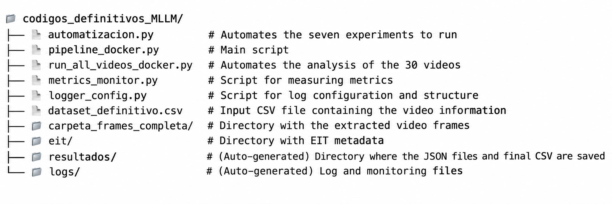

# Audiovisual Content Classifier Using Multimodal Large Language Models (MLLMs)

This project implements an advanced television content classification pipeline based on the DVB standard (ETSI EN 300 468). It uses multimodal large language models (MLLMs) to analyze EPG metadata extracted from the EIT and video frames, assigning each program to one of the 10 defined content categories.

The system also includes a hardware monitoring component that records inference latency, energy consumption (GPU/CPU through NVML and RAPL), and memory usage during inference.

---

## Project Features

The project supports several experimental configurations depending on the type of input provided to the model.

- **Text-Only Classification**: Analyzes textual EIT metadata.
- **Visual Classification**: Analyzes video frames extracted at specified time intervals.
- **Multimodal Classification**: Combines image and text inputs.

- **Two-Stage Pipeline**: Implements sequential classification strategies.

   - **visual_then_epg**: Performs frame-level visual classification and majority voting, then uses EPG metadata to determine the final category.
   - **epg_then_visual**: Uses EPG metadata to identify the top three candidate categories, leaving the final decision to visual analysis.

**Resource Monitoring**: Tracks GPU utilization, VRAM, RAM, energy consumption (joules), power consumption (watts), and generation throughput (tokens/s) using `NVML` and `pyRAPL`.

* **Detailed Reports:** Automatically generates JSON files for each program and a consolidated CSV report, comparing model predictions against both manual annotations and broadcaster-provided EPG labels.

---

## System Architecture and Modules

The workflow is coordinated through several interconnected Python scripts:

* `pipeline.py`: Implements the core inference pipeline. It constructs prompts by incorporating EIT metadata, communicates with the MLLM, and parses JSON responses to ensure compliance with the required output structure.
* `metrics_monitor.py`: Runs a parallel monitoring thread to track resource usage and system performance.
* `run_all_videos.py`: Main orchestrator that traverses the directory hierarchy, loads reference labels from `dataset_definitivo.csv`, and exports evaluation metrics to CSV and JSON files.
* `automatizacion.py`: Automates batches of experiments by sequentially executing predefined configurations, such as 30-second versus 60-second sampling intervals, text-only classification, and visual-only classification.

---

## Directory Structure

The codebase should follow the directory structure shown below:



---

## Execution Command

The following command is recommended for running all classification approaches in a single execution. It generates separate output directories for text-only, visual-only, and two-stage experiments:

```bash
python automatizacion.py
```
